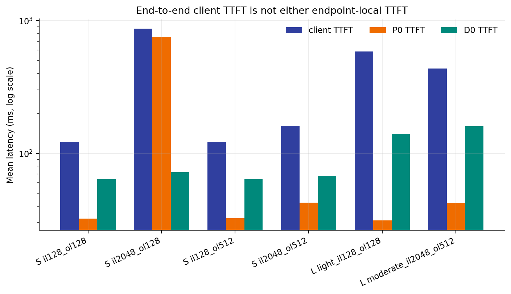
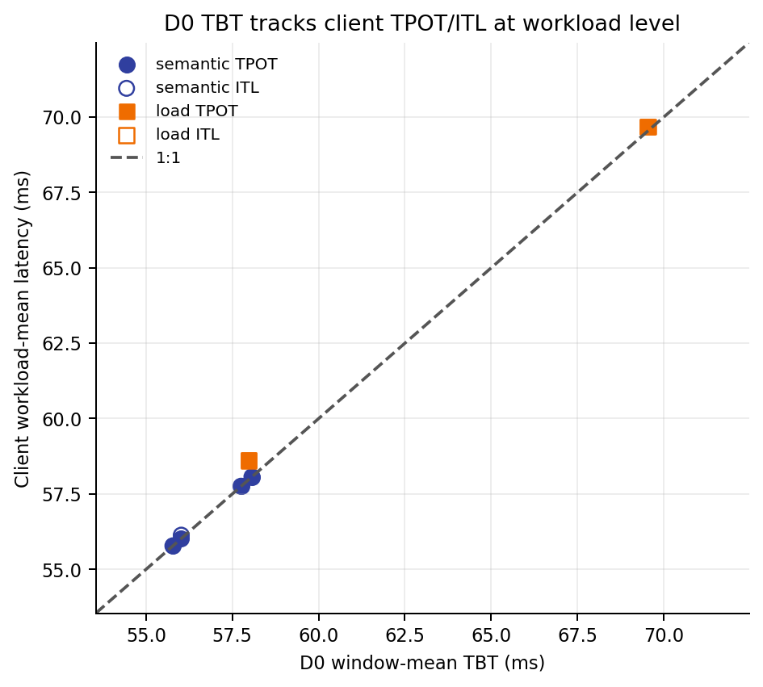
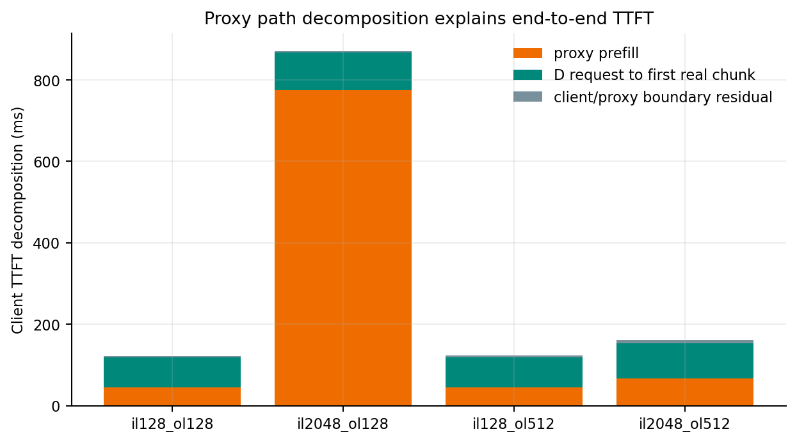
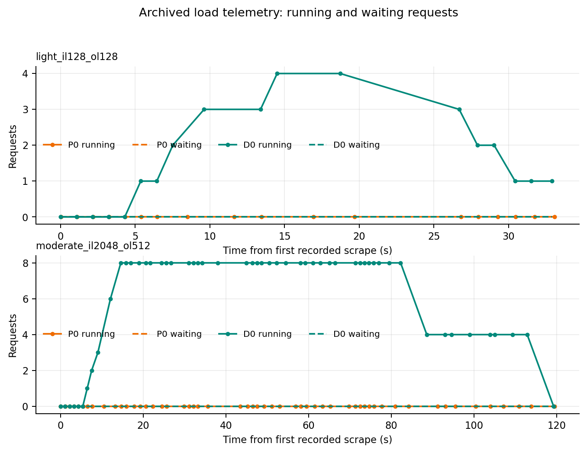
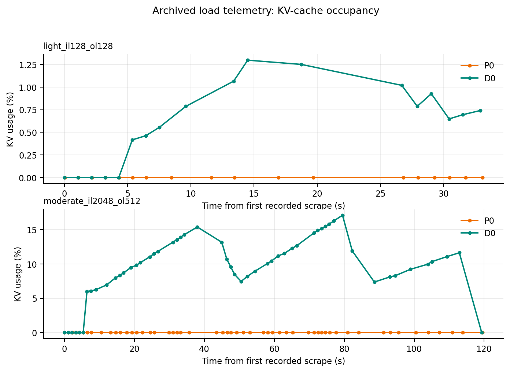
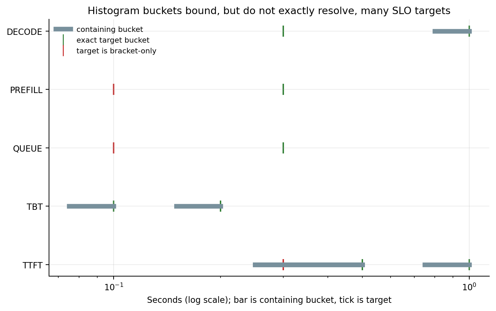

# Phase 3A scientific observability and metric-semantics summary

## 1. Experimental scope

This report analyzes only accepted run `20260818T180448Z` at commit `700759eb68100e3b03763bc8ff8567164c74415a` (Slurm job 254289). It is an offline interpretation of archived client, proxy, and Prometheus artifacts. It starts no server, submits no job, and changes no model, harness, endpoint, GPU, or raw result. The rejected historical run `20260818T172017Z` is explicitly excluded.

## 2. Dataset and acceptance boundary

Acceptance audit: **PASS**, with 52 invariants passed and zero failed. The archive contains four one-request semantic probes, a 10-request light load, a 20-request moderate load, 35 completed real-SSE proxy diagnostics including warmup, zero failed client requests, zero scrape errors, and zero detected counter resets. The analysis source digest (excluding `analysis/`) is `3f21a52be2af26cac4ffc337e246f48fb42318b2b0bf9fa380d327acdae3aace`.

The controller's dry-run mode was disabled, so no dry-run comparison is available. “Real SSE” here means all stored proxy diagnostics record a streaming upstream response and at least one real chunk; the archive does not contain an independent packet capture.

Artifact-level provenance is in `artifact_provenance.csv`. Exact regeneration:

```bash
PYTHONPATH=paper/scripts .venv/bin/python -m xpyd.phase3a_scientific --run-dir /data/users/chjing/vLLM_test/results/xpyd_observability/20260818T180448Z
```

## 3. Prefill/decode accounting semantics

| workload | logical req. | P prompt | D prompt | P gen. | D gen. | P success | D success |
| --- | --- | --- | --- | --- | --- | --- | --- |
| semantic_il128_ol128 | 1 | 129.000 | 129.000 | 1.000 | 128.000 | 1.000 | 1.000 |
| semantic_il2048_ol128 | 1 | 2049.000 | 2049.000 | 1.000 | 128.000 | 1.000 | 1.000 |
| semantic_il128_ol512 | 1 | 129.000 | 129.000 | 1.000 | 512.000 | 1.000 | 1.000 |
| semantic_il2048_ol512 | 1 | 2049.000 | 2049.000 | 1.000 | 512.000 | 1.000 | 1.000 |
| load_light_il128_ol128 | 10 | 1290.000 | 1290.000 | 10.000 | 1280.000 | 10.000 | 10.000 |
| load_moderate_il2048_ol512 | 20 | 40980.000 | 40980.000 | 20.000 | 10240.000 | 20.000 | 20.000 |

Server prompt counters include one extra token per request relative to requested input length, consistent across P0 and D0 in this run. P0 generation advances by one token per logical request, while D0 generation equals requested output tokens. Both P0 and D0 success counters advance once per logical request: they are phase-local observations of the same requests and **must not be added** to estimate user request throughput.

## 4. Latency semantics and cross-layer correspondence

All values below are milliseconds and are workload means. Endpoint values are Prometheus window aggregates, not per-request observations.

| workload | client TTFT | P0 TTFT | D0 TTFT | client TPOT | client ITL | D0 TBT | client E2E |
| --- | --- | --- | --- | --- | --- | --- | --- |
| semantic_il128_ol128 | 121.924 | 32.153 | 63.940 | 55.786 | 55.781 | 55.779 | 7206.729 |
| semantic_il2048_ol128 | 870.338 | 751.787 | 72.221 | 57.762 | 57.757 | 57.753 | 8206.110 |
| semantic_il128_ol512 | 122.493 | 32.352 | 63.851 | 56.025 | 56.134 | 56.021 | 28751.380 |
| semantic_il2048_ol512 | 161.016 | 42.483 | 67.719 | 58.071 | 58.070 | 58.068 | 29835.278 |
| load_light_il128_ol128 | 584.858 | 31.214 | 140.149 | 58.615 | 58.614 | 57.979 | 8029.006 |
| load_moderate_il2048_ol512 | 436.233 | 42.259 | 160.668 | 69.684 | 69.684 | 69.536 | 36044.873 |





D0 TBT is the strongest telemetry-to-client correspondence in this archive: against six workload means, client TPOT has mean absolute difference 0.135 ms and Pearson/Spearman 0.999/0.943; client ITL has mean absolute difference 0.150 ms and Pearson/Spearman 0.999/0.943. These correlations are exploratory at n=6 and must not be presented as a population estimate.

P0 TTFT and D0 TTFT are intrinsic phase-local startup measurements; neither equals end-to-end client TTFT. Proxy timestamps support a composed path interpretation—prefill plus D-request-to-first-real-chunk plus a small client/proxy boundary residual. Across the four strictly phase-aligned semantic probes, the mean absolute residual is 4.522 ms.



For load requests, client `trace_request_id` and proxy `request_id` belong to different identifier domains. Request-level load comparisons therefore use only ordinal alignment after sorting client send time and proxy receive time; they are useful diagnostics, not a proof of one-to-one identity. No per-request endpoint TTFT/TBT is fabricated.

## 5. Queue, concurrency, and KV-cache observations

| load | endpoint | n | max running | max waiting | max KV | max prompt tok/s | max gen. tok/s | max scrape gap (s) |
| --- | --- | --- | --- | --- | --- | --- | --- | --- |
| load_light_il128_ol128 | D0 | 18 | 4.000 | 0.000 | 0.013 | 120.527 | 67.565 | 7.967 |
| load_light_il128_ol128 | P0 | 18 | 0.000 | 0.000 | 0.000 | 120.260 | 0.932 | 7.143 |
| load_moderate_il2048_ol512 | D0 | 54 | 8.000 | 0.000 | 0.171 | 3614.747 | 118.087 | 7.006 |
| load_moderate_il2048_ol512 | P0 | 54 | 0.000 | 0.000 | 0.000 | 4758.865 | 2.323 | 7.861 |





D0 reached running concurrency 8 with no observed waiting and maximum KV occupancy about 17.1%; P0's archived interval snapshots stayed at zero running/waiting/KV. Across semantic and load before/after windows, the largest endpoint histogram mean queue time was only 0.104 ms. Thus this run shows active decode/KV pressure but no observed queue buildup. P0 prompt-token-rate spikes nevertheless confirm work that its short running intervals did not capture. Although every scrape succeeded, per-endpoint scrape-start gaps reached about 8 s because collection was blocking/nonuniform. Consequently, the rate peaks and interval series are coarse observability samples and should not drive a fine-grained feedback controller.

The light and moderate runs differ simultaneously in input length, output length, request count, rate, duration, and concurrency. Their performance must not be interpreted as a controlled load-scaling curve.

## 6. Histogram resolution and SLO implications

Across the selected endpoint/metric targets, 16 target checks have an exact bucket and 6 are bracket-only. In particular, TTFT 300 ms falls between 250 and 500 ms, while queue/prefill/decode histograms begin too coarsely for many sub-300-ms claims. Histogram-derived quantiles identify a containing bucket, not an exact latency.



For future SLO enforcement, preserve direct client measurements and add bucket boundaries at every policy threshold before relying on Prometheus histogram quantiles.

## 7. Hypothesis assessments

- **H1 — supported (workload-level exploratory):** D0 TBT is the closest endpoint metric to client TPOT/ITL. Boundary: Six workload means; endpoint TBT is not available per request.
- **H2 — supported (descriptive):** P0 TTFT is an intrinsic prefill-side phase metric, not client TTFT. Boundary: Four isolated semantic probes; descriptive, not a fitted law.
- **H3 — supported (descriptive):** D0 TTFT is an intrinsic decode-side startup metric, not client TTFT. Boundary: Four isolated semantic probes; descriptive, not a fitted law.
- **H4 — supported (proxy-timestamp decomposition):** End-to-end TTFT is a composed P/D path quantity. Boundary: Semantic probes align by phase order. Multi-request load alignment is ordinal because client and proxy artifacts have no shared request identifier.

The four isolated semantic points establish measurement semantics and accounting consistency; they do not establish a universal performance law or justify fitting a predictive surface.

## 8. Operational implications

- Use D0 TBT as the initial telemetry proxy/ranker for client TPOT/ITL, then recalibrate against live XpYd workloads.
- Treat client TTFT as a composed path objective; retain P0 and D0 TTFT for phase diagnosis rather than substituting either for the client metric.
- Keep logical request accounting separate from endpoint-local success counters.
- Use running/waiting/KV series for coarse capacity diagnosis only at this sampling cadence.
- Treat histogram p99 values as bucket-bounded estimates and report their bucket interval.

## 9. Limitations

This is one accepted job on one P0/D0 pairing, with four single-request semantic probes and two confounded load shapes. There are no repetitions, confidence intervals, randomized order, failure cases, energy readings, GPU power telemetry, endpoint-level per-request histograms, or independent SSE packet capture. Dry-run evidence is unavailable because it was disabled. Proxy/client request identity is absent for multi-request phases. Archived telemetry is sparse and nonuniform. These constraints support semantics validation and initial proxy selection, not causal or fleet-wide conclusions.

## 10. Phase 3B recommendation: read-only energy observability

Add read-only, endpoint-separated P0/D0 power and energy sampling without changing the serving path. Record idle baselines and background draw; keep logical request counts distinct from P0/D0 phase counters; report measurement coverage and integration gaps; and explicitly mark KV-transfer/network energy as unobserved unless separately instrumented. Do not sum P0 and D0 request-success counters. Normalize energy as joules per logical request and additionally by workload shape (input tokens, output tokens, and active context), so later comparisons do not confuse work composition with energy efficiency.
